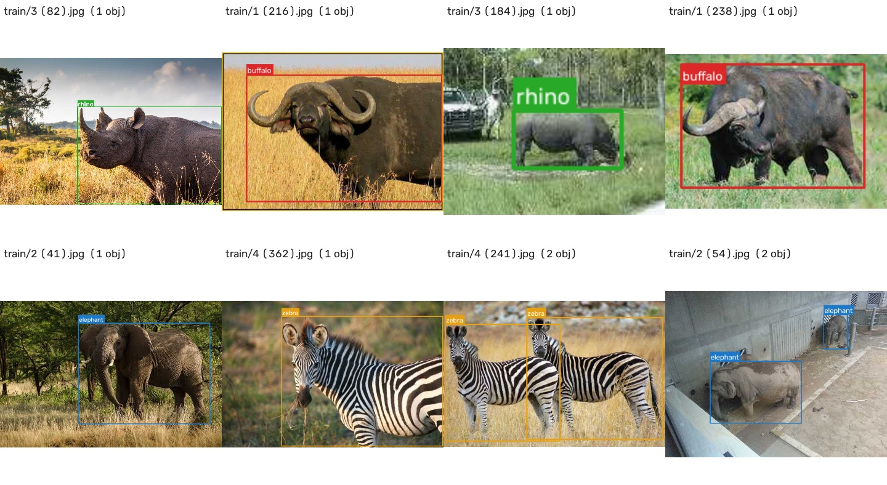
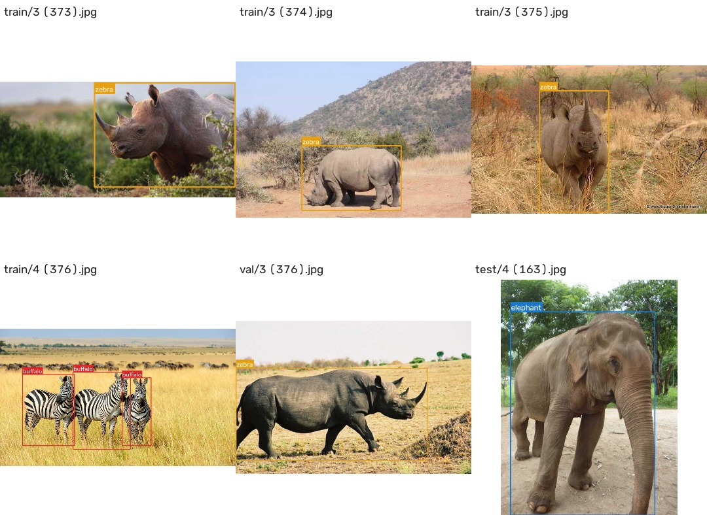
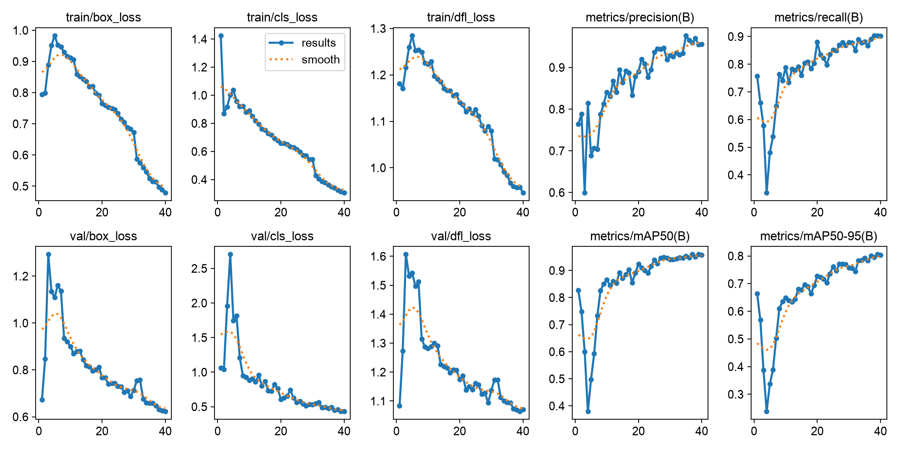
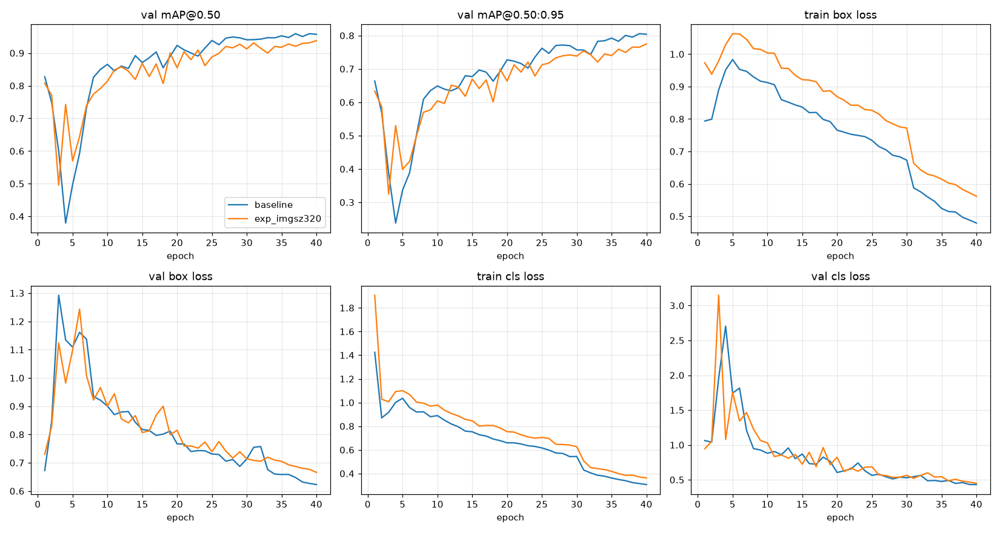
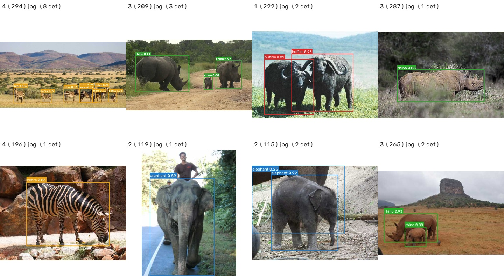
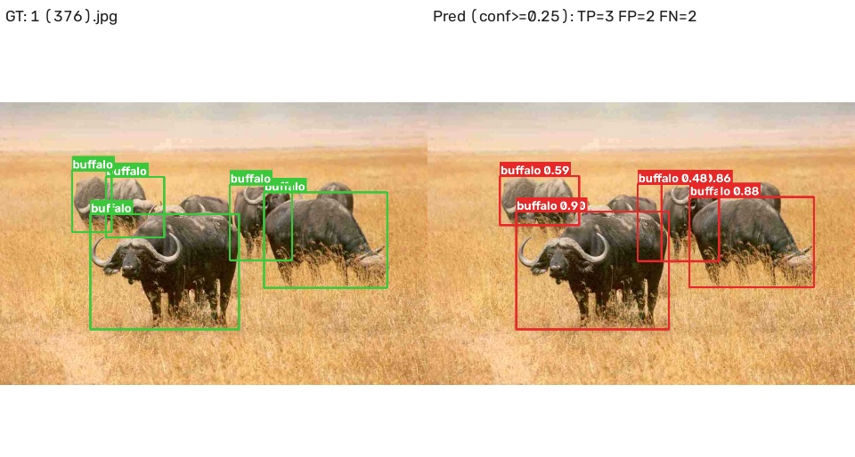
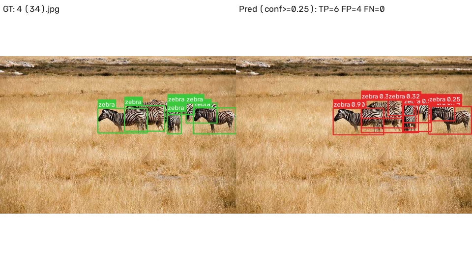
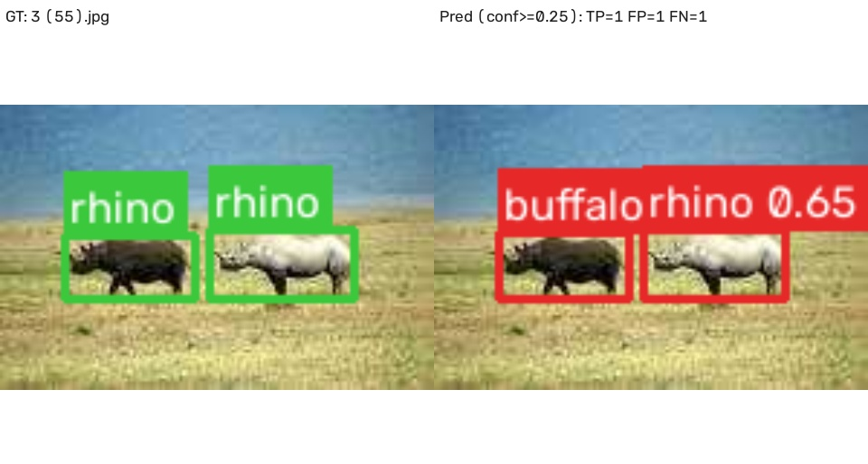

# African Wildlife Detector — fine-tuning YOLO11n

[](https://colab.research.google.com/github/Estiyar/DL-Bonus/blob/main/notebooks/train_detector.ipynb)

**CSCI1409 Deep Learning, bonus project: train an object detector.**
This repository lets anyone reproduce the whole pipeline in Google Colab: data preparation and cleaning,
fine-tuning a pretrained detector, a controlled experiment, held-out test evaluation and failure analysis.

| | Value |
|---|---|
| Task | Detect and classify 4 African animals: **buffalo, elephant, rhino, zebra** |
| Model | Ultralytics **YOLO11n** (2.6 M parameters), fine-tuned from the COCO-pretrained `yolo11n.pt` |
| Final model | `baseline` (imgsz 640), selected on the **validation** set |
| **Test results** (206 images, 341 objects) | **Precision 0.966 · Recall 0.918 · mAP@0.50 0.973** · mAP@0.50:0.95 0.822 |
| Final checkpoint | [`baseline_best.pt` (5.5 MB)](https://github.com/Estiyar/DL-Bonus/releases/download/v1.0/baseline_best.pt) |

---

## Contents
1. [Quick start](#1-quick-start)
2. [Repository structure and credits](#2-repository-structure-and-credits)
3. [Dataset](#3-dataset)
4. [Baseline training](#4-baseline-training)
5. [Controlled experiment: image size 640 → 320](#5-controlled-experiment-image-size-640--320)
6. [Final evaluation on the test set](#6-final-evaluation-on-the-test-set)
7. [Failure analysis](#7-failure-analysis)
8. [Limitations](#8-limitations)
9. [Acknowledgements and use of AI assistance](#9-acknowledgements-and-use-of-ai-assistance)

---

## 1. Quick start

### Google Colab (recommended)
1. Click **Open in Colab** above.
2. `Runtime → Change runtime type → T4 GPU` (the free tier is enough).
3. `Runtime → Run all`.

The notebook clones this repository, installs the pinned dependencies, downloads and cleans the data, trains both
runs, compares them on validation, evaluates the selected model on test, and shows predictions and failure cases.
Settings in the first cell:
- `TRAIN = False` skips training and downloads the released checkpoint.
- `EPOCHS = 2` runs a quick (~5 min) smoke test of the full pipeline.

Full training of both runs takes about 30–40 min on a T4.

### Local
```bash
git clone https://github.com/Estiyar/DL-Bonus.git
cd DL-Bonus
python -m venv .venv && source .venv/bin/activate
pip install torch torchvision            # CUDA / MPS / CPU build for your machine
pip install -r requirements.txt

python scripts/prepare_data.py           # download (SHA-256 checked), fix split + labels, write data.yaml
python scripts/check_dataset.py          # statistics, label checks, duplicate search
python scripts/visualize_gt.py           # ground-truth examples
python scripts/train.py --config configs/baseline.yaml
python scripts/train.py --config configs/exp_imgsz320.yaml
python scripts/compare_runs.py baseline exp_imgsz320           # val table + selects the final run
python scripts/evaluate.py --weights weights/baseline_best.pt --split test
python scripts/predict.py  --weights weights/baseline_best.pt  # or --source my_photo.jpg
python scripts/failure_analysis.py --weights weights/baseline_best.pt
```

### Use the trained model only
```bash
wget https://github.com/Estiyar/DL-Bonus/releases/download/v1.0/baseline_best.pt -P weights/
python scripts/predict.py --weights weights/baseline_best.pt --source path/to/image.jpg --out pred.jpg
```
Checkpoint SHA-256: `0b71c8fad11ad52e4f8b03a7961991f3ea86d853a71b6977a6017434bf3d312e`

---

## 2. Repository structure and credits

```
configs/
  baseline.yaml          training config of the baseline run
  exp_imgsz320.yaml      identical config, only imgsz changed (the controlled experiment)
  split_fixes.yaml       29 images moved between splits to remove duplicate leakage
  label_fixes.yaml       7 wrong class ids corrected (5 images)
notebooks/
  train_detector.ipynb   end-to-end Colab notebook
scripts/
  prepare_data.py        download + checksum + apply split/label fixes + write data.yaml
  check_dataset.py       per-split statistics, label validation, pHash near-duplicate search
  fix_splits.py          builds split_fixes.yaml from the duplicate search (union-find groups)
  visualize_gt.py        ground-truth examples
  train.py               trains one config, re-validates best.pt, saves evidence to results/<run>/
  compare_runs.py        validation comparison table, learning curves, final-model selection
  evaluate.py            evaluation on the test split (P, R, mAP@0.50, mAP@0.50:0.95)
  predict.py             predictions with class names and confidences
  failure_analysis.py    TP/FP/FN matching, error categories, failure images; also used for the label audit
  common.py, viz.py      shared helpers
results/                 all evidence (metrics json, logs, curves, plots, images), see below
logs/                    console training logs of both runs
requirements.txt         pinned dependency versions
```

**What comes from other projects:** the detector architecture, training loop, augmentation, loss and metric
implementation are from [Ultralytics](https://github.com/ultralytics/ultralytics) (AGPL-3.0), used as a library
without modification. The dataset and the pretrained `yolo11n.pt` weights are also published by Ultralytics.

**My additions:** all scripts in `scripts/`, the configs, the notebook, the data audit (duplicate detection and
split repair, label checks and corrections), the controlled experiment, the final-model selection rule, the
TP/FP/FN failure-analysis tool and the written analysis.

---

## 3. Dataset

### Source and terms of use
- **African Wildlife** dataset by Ultralytics: <https://docs.ultralytics.com/datasets/detect/african-wildlife/>
- Download: `https://github.com/ultralytics/assets/releases/download/v0.0.0/african-wildlife.zip` (~100 MB, SHA-256 `6b97a768…0040061`, checked by `prepare_data.py`)
- License: **AGPL-3.0** (the `LICENSE.txt` in the archive; this repository uses the same license). The images are photographs collected from the web for research and education.

### Classes and annotation format
| id | class |
|---|---|
| 0 | buffalo |
| 1 | elephant |
| 2 | rhino |
| 3 | zebra |

Annotations are in **YOLO format**: one `.txt` per image, one line per object:
`class_id x_center y_center width height`, with all coordinates normalised to [0, 1] by the image size.
Folder layout: `images/{train,val,test}/*.jpg` and `labels/{train,val,test}/*.txt`.

### Images and objects per split (final split used for all experiments)
| Split | Images | Objects | buffalo | elephant | rhino | zebra |
|---|---:|---:|---:|---:|---:|---:|
| train | 1080 | 1978 | 413 | 565 | 413 | 587 |
| val | 218 | 366 | 86 | 87 | 83 | 110 |
| test | 206 | 341 | 52 | 96 | 67 | 126 |
| **total** | **1504** | **2685** | **551** | **748** | **563** | **823** |

The original release split was 1052 / 225 / 227 images (see `results/dataset/stats_original_split.md`).
Most images contain one or two large animals. 18 images contain more than one class, and 11 test images are
crowded scenes with 4 or more animals.

### Ground-truth examples


More examples are in `results/dataset/gt_examples_test.jpg`.

### Data checks

**1. Automatic label validation** (`check_dataset.py`). Every image was opened and verified, and every label line checked for:
- missing label files and images without boxes;
- invalid class ids and coordinates outside [0, 1];
- boxes outside the image, boxes under 4 px, duplicated boxes.

**Result: no issues** (`results/dataset/label_issues.csv`).

**2. Duplicates and split leakage.**
- A 64-bit perceptual hash (pHash) was computed for every image, and all 1.1 M pairs were compared.
- Pairs with Hamming distance ≤ 6 were inspected visually. All of them were the same photo: re-encoded, resized or with a border.
- 69 near-duplicate pairs were found, and **32 of them crossed splits**: the original release has the *same photo* in train and in val/test. That leaks training images into evaluation and inflates the scores.

**Fix** (`fix_splits.py`, deterministic, no random seed involved):
- Pairs were merged into groups with union-find.
- Every group spanning several splits was moved entirely into one split, with priority train > val > test.
- This moved 29 images: 8 val → train, 20 test → train, 1 test → val (listed in `configs/split_fixes.yaml`).

After the fix there are **0 cross-split duplicates**. Duplicates within one split are allowed by the task and were kept.
The rest of the official split was kept unchanged; there are no video frames in this dataset.

**3. Wrong class labels.** Two independent checks found the same errors:
- **Filename check.** Files are named `<k> (<n>).jpg`, where `k` is the class the photo was collected for. `check_dataset.py` flags images with no box of that class.
- **Model-assisted audit.** A first baseline model was run on train/val. Confident predictions that disagree with the ground truth point to possible label errors (candidates listed in `results/_before_label_fix/label_audit/*/failures.csv`).

Visual inspection confirmed **5 images with wrong class ids (7 boxes)**:
- 4 rhinos labelled *zebra* (train ×3, val ×1);
- 1 image of 3 zebras labelled *buffalo* (train).



*(last tile: `test/4 (163).jpg` is flagged only because of its file name; the image really shows an elephant and its label is correct.)*

These were corrected in `configs/label_fixes.yaml`, applied automatically by `prepare_data.py`.
**Both runs were then retrained from scratch** on the corrected labels. All results below use the corrected data.
The audit also showed **incomplete labels**: some animals in the background of herd photos have no box
(e.g. `train/1 (101).jpg`). These were not added, because that would require full re-annotation; see [Limitations](#8-limitations).

---

## 4. Baseline training

| Setting | Value |
|---|---|
| Framework | Ultralytics **8.4.216**, PyTorch 2.15.0, Python 3.15.2 |
| Model / initial weights | YOLO11n / `yolo11n.pt` (official COCO-pretrained checkpoint; detection head re-initialised for 4 classes) |
| Image size | 640 |
| Batch size | 16 |
| Epochs | 40 (no early stopping) |
| Optimizer / learning rate | SGD, lr0 = 0.01 → linear decay to 0.0001 (lrf = 0.01), momentum 0.937, weight decay 5e-4, 3 warm-up epochs |
| Augmentation | Ultralytics defaults: mosaic (off in the last 10 epochs), HSV jitter, horizontal flip 0.5, scale ±0.5, translate 0.1 |
| Random seed | 42, `deterministic=True` |
| Hardware | Apple M5 laptop GPU (PyTorch MPS backend), local training |
| **Training time** | **27.2 min** (40 epochs, including per-epoch validation) |
| Checkpoint selection | `best.pt` = epoch with the highest **validation** fitness (0.1·mAP@0.50 + 0.9·mAP@0.50:0.95) → epoch 39 |

Evidence in `results/baseline/`:
- `args.yaml`: full resolved configuration;
- `results.csv`: per-epoch log of losses and validation metrics;
- `results.png`: learning curves;
- `metrics_val.json`: metrics of the selected checkpoint;
- `confusion_matrix.png`, `BoxPR_curve.png`: validation confusion matrix and precision-recall curve.

The console log is in `logs/train_baseline.log`.



**Reading the curves:**
- The dip in validation mAP around epochs 3–5 is the end of warm-up: the learning rate reaches its peak while the new 4-class head is still poorly calibrated.
- Training losses drop sharply at epoch 30, when mosaic augmentation is switched off and the model trains on "normal" images.
- Validation losses still decrease at epoch 40, so there is **no sign of overfitting**. Somewhat longer training could still help slightly.

---

## 5. Controlled experiment: image size 640 → 320

**One intentional change:** `imgsz` 640 → 320 (`configs/exp_imgsz320.yaml`).
Everything else is identical:
- the same data split and corrected labels;
- the same initial checkpoint `yolo11n.pt`;
- the same seed, epochs, batch size, optimizer, learning rate and augmentation.

**Hypothesis (stated before training).** Halving the input resolution reduces the number of pixels 4×. This will
make training roughly 2–3× faster but **lower recall and mAP**, because:
- animals that are small or far away (herds, distant zebras) get only a few pixels;
- distinguishing details such as horns, ears and stripes get blurred.

The drop should be moderate, not dramatic, because most animals in this dataset are large and fill much of the frame.

### Validation results
| Run | imgsz (changed) | Precision | Recall | mAP@0.50 | mAP@0.50:0.95 | Best epoch | Train time |
|---|---:|---:|---:|---:|---:|---:|---:|
| **baseline** | **640** | **0.960** | **0.891** | **0.959** | **0.802** | 39 | 27.2 min |
| exp_imgsz320 | 320 | 0.942 | 0.873 | 0.938 | 0.775 | 40 | 9.2 min |

Per-class val mAP@0.50 (640 → 320):
- buffalo 0.965 → 0.939;
- elephant 0.936 → 0.906;
- rhino 0.969 → 0.961;
- zebra 0.967 → 0.945.



### Explanation
- **The hypothesis is confirmed.** At 320 px every metric is lower: −2.1 points of mAP@0.50, −1.8 points of recall, −2.7 points of mAP@0.50:0.95. Training is **3.0× faster**.
- **Why speed-up is only 3×.** The pixel count is 4× smaller, but data loading, augmentation and validation are fixed costs that do not shrink with the image.
- **Why accuracy drops.** YOLO11n predicts on feature maps with strides 8/16/32. At 320 px, the finest map is only 40×40 cells, so a 40-px animal shrinks to 20 px and covers ~2 cells. Fine texture cues are lost.
- **Per-class pattern.** The largest drops are for **elephant and buffalo**: herds of small, overlapping animals often appear in these classes. **Rhino** barely changes: usually one large animal with a distinctive silhouette.
- **Training curves.** The 320 run also has higher *training* box and class losses throughout. The model fits even the training data worse, because the information is simply not in the low-resolution input. This is underfitting, not a generalisation problem.
- **The drop is small (~2 points).** Most objects are large, which matches the "moderate drop" part of the hypothesis.

**Decision (validation only):** the baseline (640) has the higher val mAP@0.50 and is selected as the final model
(rule in `compare_runs.py`: max val mAP@0.50, tie-break val mAP@0.50:0.95 → `results/final_run.json`).
The 320 model would be a reasonable choice only if speed mattered more than ~2 points of mAP.

---

## 6. Final evaluation on the test set

The test split was used **once**, after the final model had been chosen on validation. No setting was tuned on test.

| Metric (test, 206 images, 341 objects) | Value |
|---|---:|
| **Precision** | **0.966** |
| **Recall** | **0.918** |
| **mAP@0.50** | **0.973** |
| mAP@0.50:0.95 | 0.822 |

| Class | Precision | Recall | mAP@0.50 | mAP@0.50:0.95 |
|---|---:|---:|---:|---:|
| buffalo | 0.975 | 0.885 | 0.949 | 0.829 |
| elephant | 0.978 | 0.875 | 0.983 | 0.794 |
| rhino | 0.985 | 0.983 | 0.991 | 0.917 |
| zebra | 0.928 | 0.929 | 0.967 | 0.748 |

**Evaluation settings:**

| Setting | Value |
|---|---|
| Image size | 640 |
| Confidence threshold | 0.001 (keeps almost all predictions so the full precision-recall curve can be computed) |
| NMS IoU threshold | 0.7 |
| Matching IoU | a prediction counts as correct for **mAP@0.50** if IoU ≥ 0.50 with an unmatched ground-truth box of the same class |
| Precision / Recall | reported at the confidence threshold that maximises the mean F1-score |

At a fixed operating point of conf ≥ 0.25 (used for the images below), precision = 0.880 and recall = 0.947
(`results/failures/summary.json`).

Files: `results/test/metrics_test.json`, `confusion_matrix.png`, `BoxPR_curve.png`.

### What the metrics measure
- **IoU (Intersection over Union):** the overlap area of the predicted and true box divided by their union area. 1 = perfect box, 0 = no overlap.
- **Precision = TP / (TP + FP):** of all boxes the model predicted, the share that are correct (right class, IoU ≥ 0.5). Low precision = many false alarms.
- **Recall = TP / (TP + FN):** of all real animals, the share the model found. Low recall = many missed animals.
- **AP (average precision):** the area under the precision–recall curve of one class, obtained by sweeping the confidence threshold. It summarises the precision/recall trade-off over all thresholds.
- **mAP@0.50:** AP averaged over the 4 classes, with a match requiring IoU ≥ 0.5.
- **mAP@0.50:0.95:** the same, averaged over IoU thresholds 0.50, 0.55, …, 0.95. It also rewards tight box placement.

**Note on test > val:** test mAP@0.50 (0.973) is slightly higher than val (0.959). With ~350 objects per split,
a difference of 1–2 points is within normal sampling variation. In addition, val contains more crowded scenes:
8.7 % of val images have ≥ 4 animals, against 5.3 % of test images, and crowded scenes are the hardest case (§7).
Test was not used for any decision, so this is not a sign of leakage (cross-split duplicates were removed in §3).

### Predictions on test images
Class name and confidence on every box; conf ≥ 0.25.



---

## 7. Failure analysis

`failure_analysis.py` matches the predictions (conf ≥ 0.25) to the ground truth (IoU ≥ 0.5) and classifies every error.
On the 206 test images there are **323 TP, 44 FP and 18 FN**. 40 images contain at least one error.

| Error type | Count |
|---|---:|
| missed object (FN) | 18 |
| false positive (no matching GT, including duplicate boxes) | 33 |
| poor localisation (right class, 0.1 ≤ IoU < 0.5) | 10 |
| wrong class (IoU ≥ 0.5, other class) | 1 |

**Crowded scenes are the main weakness:** the 11 test images with ≥ 4 animals (5 % of the images) contain
19 of the 62 FP+FN errors (31 %). All errors are listed in `results/failures/failures.csv`.

Each image below shows the ground truth on the left (green) and the predictions on the right (red).

### Failure 1: missed and merged animals in a buffalo herd (`test/1 (376).jpg`)


**What happens:** the herd contains 5 labelled buffalo that strongly overlap.
- The model finds the 3 front/right ones (confidence 0.86–0.90).
- The two partly hidden buffalo on the left are **merged into one box** (0.59). That box overlaps each animal with IoU < 0.5, so it counts as poor localisation and both animals count as **missed**.
- A second, duplicate box (0.48) is placed on the middle animal, which counts as a false positive.

**Likely causes:**
1. Heavy occlusion: only parts of the animals behind are visible.
2. Uniform dark bodies: the boundary between two adjacent buffalo is barely visible.
3. Non-maximum suppression (IoU 0.7) can remove a correct box that overlaps a neighbouring one strongly.
4. Training data is dominated by images with 1–2 large animals, so crowded herds are rare.

### Failure 2: false detections in an overlapping zebra group (`test/4 (34).jpg`)


**What happens:** the model finds all six zebras (no misses), but adds **4 extra low-confidence boxes** (0.25–0.37).
These boxes cover the stripes of two neighbouring zebras together, or the gap between them.

**Likely causes:**
1. When zebras overlap, their stripes merge into one continuous pattern, and the network cannot tell where one animal ends.
2. The extra boxes overlap the true boxes by less than the NMS IoU of 0.7, so NMS keeps them.
3. The animals are small: the image is wide and the group occupies a thin horizontal strip.

All extra boxes have low confidence. With a threshold of 0.4 instead of 0.25 they would disappear, at the cost of slightly lower recall.

### Failure 3: rhino classified as buffalo (`test/3 (55).jpg`)


**What happens:** this low-resolution, blurry image shows a dark rhino and a light rhino from the side.
- The light rhino is detected correctly (0.65).
- The **dark rhino is classified as buffalo (0.76)**, although the box itself is almost perfect (IoU 0.96).

This is the only wrong-class error on the whole test set.

**Likely causes:**
1. The image is tiny and blurry, so the horn (the most discriminative rhino feature) is only a few pixels.
2. What remains is a dark, bulky body on grass, and in the training data that colour and shape are typical of buffalo (black hide, side view).
3. The model relies on colour and texture when shape details are missing.

### Practical next step
Most errors (failures 1 and 2, and 31 % of all FP+FN) come from **small, overlapping animals in herds**.
The experiment in §5 showed that resolution matters: going from 640 to 320 hurt most on these scenes.
**The next step is to fine-tune at a higher resolution (`imgsz=960`) with the same config.** This would give small
and partly hidden animals more pixels; if GPU memory runs out on a free Colab T4, the batch size can be reduced to 8.
The new model should then be compared to the baseline on validation in the same way.
A complementary data-side step would be to label the unlabelled background animals in herd photos (see §3) and add more crowded scenes.

---

## 8. Limitations
- **Small evaluation sets.** Val and test have ~220 images and ~350 objects each, so metric differences of about 1–2 points are within sampling noise. The experiment uses a single seed per configuration; running several seeds would give error bars.
- **Incomplete labels in herds.** Some background animals are not annotated. The model is then penalised for correct detections, which counts them as FP, and learns to ignore distant animals.
- **Web photographs.** Mostly centred, well-lit, large animals. Performance on camera-trap images, night/IR images, drone footage or other species (e.g. a hippo or wildebeest) is unknown and probably much lower: the model only knows 4 classes and will force any large dark animal into one of them.
- **Hardware differences.** The reported runs were trained on an Apple M5 GPU (MPS). Re-running the notebook on a Colab NVIDIA GPU uses the same code, data and seed, but GPU kernels differ, so metrics can differ in the last digit (typically ±0.5–1 point).
- **Hyper-parameters.** Only one hyper-parameter (image size) was studied, and the schedule (40 epochs, default augmentation) was not tuned.

### Effect of the data cleaning
For transparency, the metrics of the first training run (before the 7 wrong labels were fixed) are kept in
`results/_before_label_fix/`.

| Run | Val mAP@0.50 before fix | Val mAP@0.50 after fix |
|---|---:|---:|
| baseline | 0.940 | 0.959 |
| exp_imgsz320 | 0.919 | 0.938 |

Test mAP@0.50 stayed the same (0.973 → 0.973). Part of the val gain comes from correcting one wrong val label,
so the two numbers are not a clean model comparison. The conclusion of the experiment (640 > 320 by ~2 points) is the same before and after the fix.

---

## 9. Acknowledgements and use of AI assistance
- [Ultralytics YOLO](https://github.com/ultralytics/ultralytics): framework, pretrained weights and the African Wildlife dataset (AGPL-3.0).
- [ImageHash](https://github.com/JohannesBuchner/imagehash): perceptual hashing for duplicate detection.
- **AI assistance:** an AI coding assistant (Claude, Anthropic) helped write the scripts and the notebook, and draft this README. All experiments were run, and all results and failure cases checked and analysed, by the author.

License: AGPL-3.0 (see `LICENSE`), the same as Ultralytics and the dataset.
